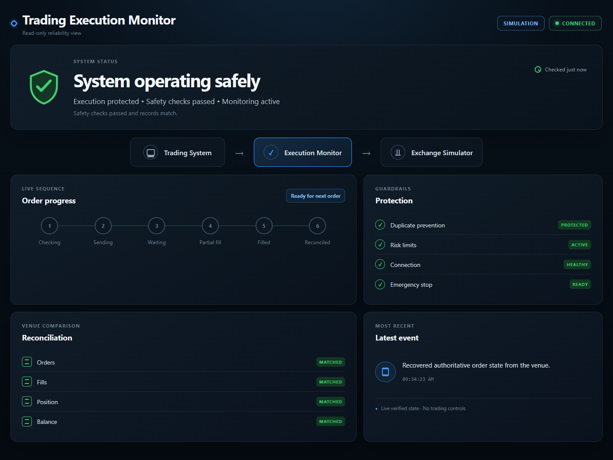
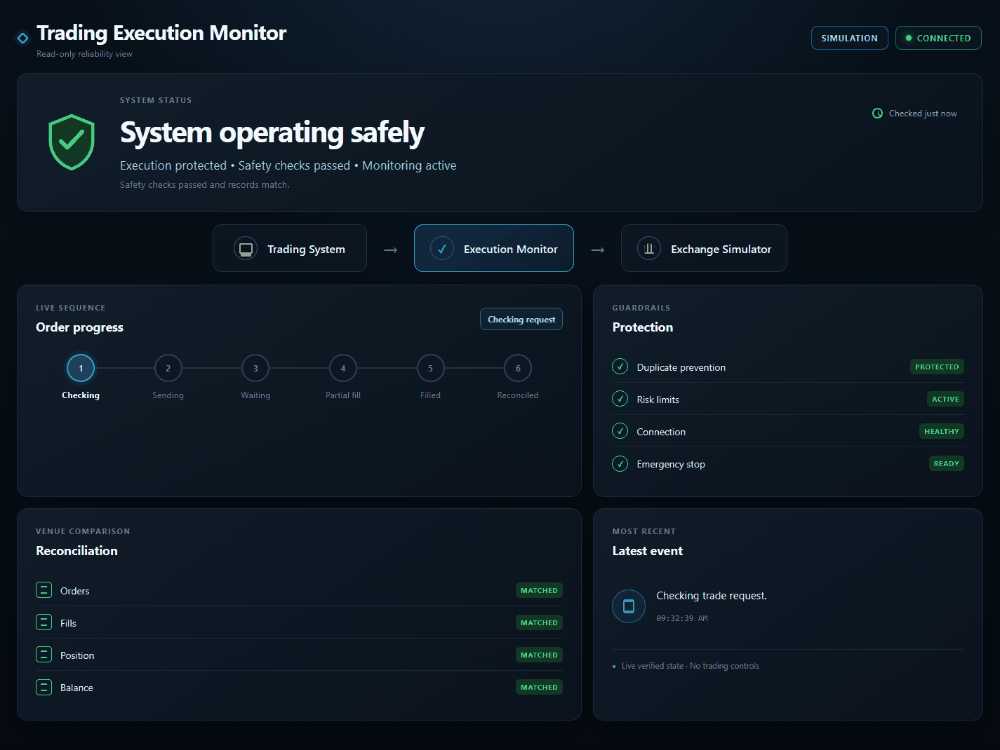

# Trading Execution Monitor

A public-safe reliability demonstration for trading-system takeover, execution safety, recovery, and handoff.

The monitor sits between a trading system and an exchange or simulator:

```text
Trading system  ->  Execution Monitor  ->  Exchange or simulator
                         |
                         +-> tests, evidence, and a read-only dashboard
```

It does not select strategies, promise returns, expose real account data, or place funded trades.





## What it proves

- Duplicate trade requests produce only one venue order.
- Risk limits block oversized requests before the venue.
- Partial fills, cancellations, and rejections keep explicit states.
- Disconnects block execution instead of guessing.
- Local orders, fills, positions, and balances reconcile with authoritative venue state.
- SQLite and the simulated venue recover after a full process restart.
- A read-only local dashboard displays the same state used by the tests.
- A frozen Coinbase BTC-USD candle sample drives a deterministic paper run without credentials.

See the [proof index](docs/PROOF_INDEX.md) for direct links to every claim.

## Quick start

Requires Python 3.11 or newer.

```powershell
python -m venv .venv
.venv\Scripts\python -m pip install -e .
.venv\Scripts\execution-monitor serve
```

Open `http://127.0.0.1:8765`. The page is read-only. Each local demo visibly moves through idle, checking, sending, waiting, partial fill, full fill, and reconciliation. It also creates a real venue/local mismatch (`WARNING`), recovers to `SAFE`, disconnects the simulator (`BLOCKED`), reconnects it, and returns to `SAFE`. Disposable simulated history resets between cycles so the preview can run continuously.

macOS or Linux uses `.venv/bin/python` and `.venv/bin/execution-monitor` instead.

## Verify everything

```powershell
python scripts/verify.py
```

That command runs all 22 automated checks, regenerates deterministic failure/recovery evidence, and runs the frozen-data paper check.

Individual commands:

```powershell
python -m unittest discover -s tests -v
execution-monitor verify
execution-monitor paper
```

Generated runtime state stays under `var/`. Safe evidence summaries are written under `evidence/`.

## Docker

```powershell
docker compose up --build
```

Open `http://127.0.0.1:8765`. Docker publishes only to the host loopback address. Stop it with `docker compose down`.

## Boundaries

- Version one uses a deterministic simulator and frozen public candles.
- No testnet or live exchange adapter is included.
- The browser has no order, cancellation, emergency-stop, or configuration controls.
- The dashboard exposes status booleans and plain-English events, not balances, credentials, wallet details, or transaction identifiers.
- A real venue adapter and any funded test require a separate design and explicit authorization.

## Documentation

- [Architecture](docs/ARCHITECTURE.md)
- [Foundation decision](docs/FOUNDATION_DECISION.md)
- [Before/after findings](docs/FINDINGS.md)
- [Recovery runbook](docs/RECOVERY.md)
- [Security and public-sharing boundary](docs/SECURITY.md)
- [Handoff](docs/HANDOFF.md)
- [Public candle source](docs/DATA_SOURCE.md)
